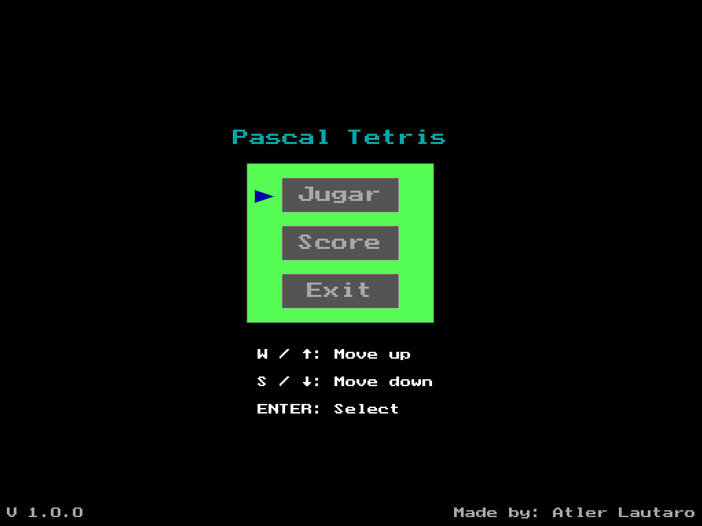
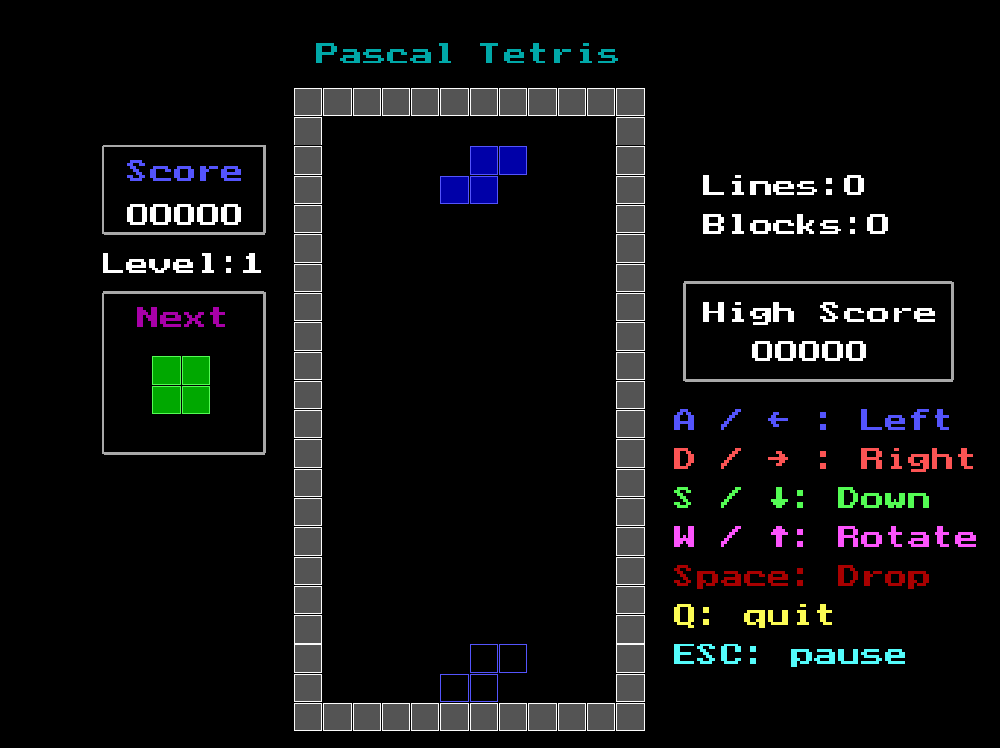
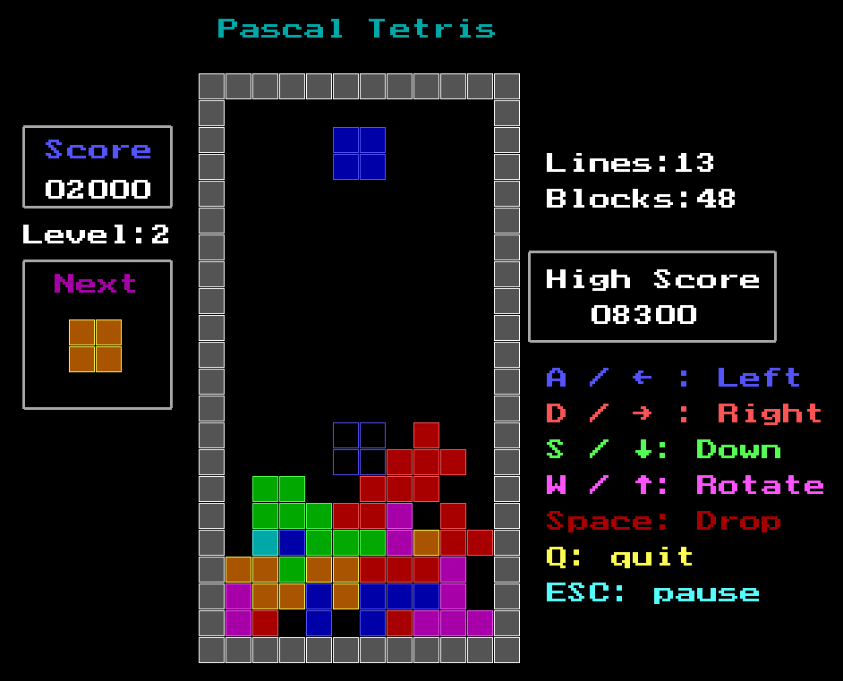
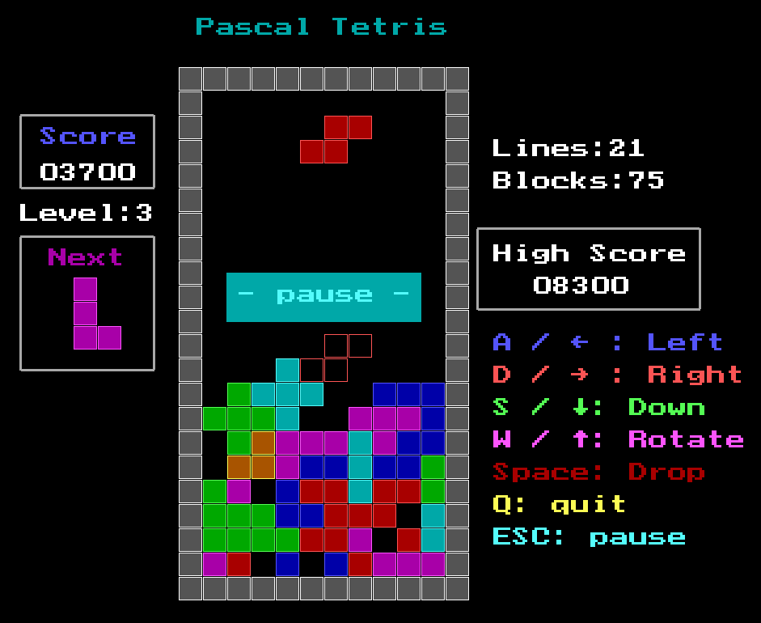
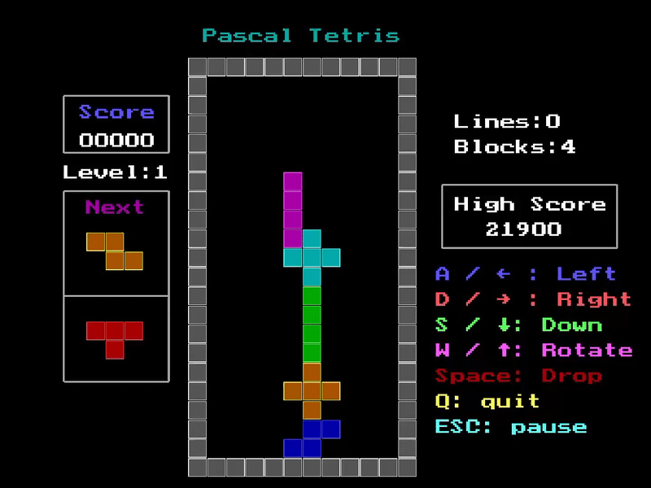
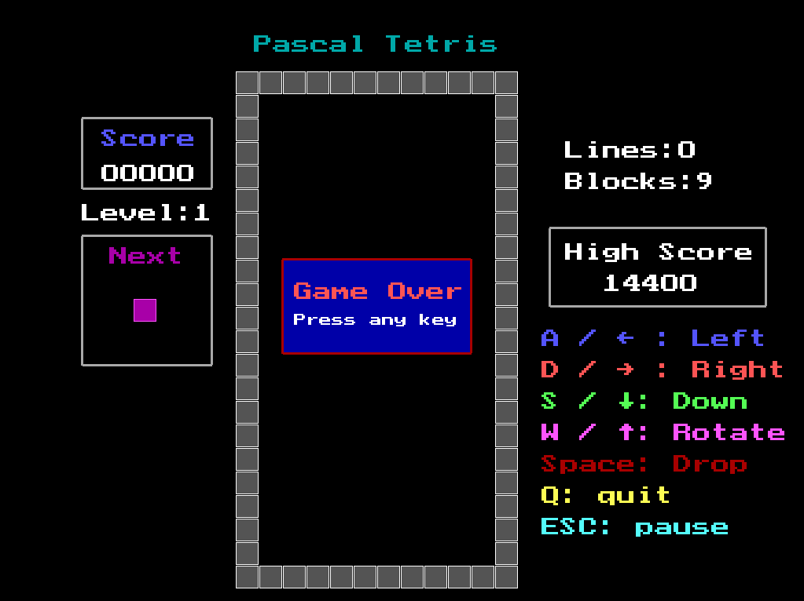
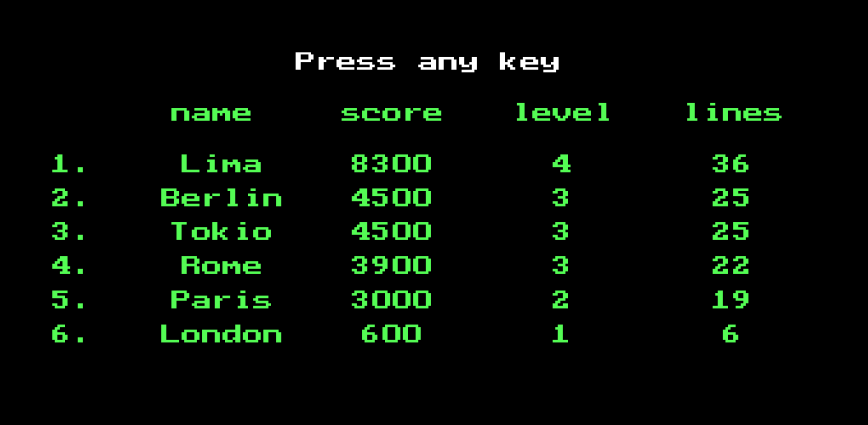

# Tetris en Pascal

## Descripción:

Este proyecto consiste en el desarrollo de un videojuego inspirado en Tetris, utilizando el lenguaje Pascal.

El objetivo del juego es acomodar las piezas que van descendiendo para completar líneas de manera horizontal y evitar que los bloques lleguen a la parte superior del tablero.

El proyecto fue desarrollado como una implementación de dicho juego, poniendo en práctica conceptos de programación, gestión de archivos, lógica y estructuras de control.

## Características:

- Movimiento de piezas.
- Rotación de bloques.
- Detección y eliminación de líneas completadas.
- Sistema de puntuación.
- Detección de fin de partida.
- Verificación de movimientos permitidos.

## Tecnologías utilizadas:

- Pascal
- Compilador utilizado: Free Pascal.

## Ejecución
Existen dos formas de descargar el juego:

### Opción 1: Descargar última versión
	
Podés descargar la versión del juego desde la sección [Releases](https://github.com/lautaroatler99-web/Tetris/releases).
	
### Opción 2: Compilar el código fuente:
	
1. Clonar o descargar este repositorio.
2. Abrir el proyecto con el entorno o compilador correspondiente.
3. Compilar el código fuente.
4. Ejecutar el programa generado .exe

## Controles:

- **A / flecha izquierda** : Mover pieza a la izquierda.
- **D / flecha derecha** : Mover pieza a la derecha.
- **W / flecha arriba** : Rotar pieza.
- **S / flecha abajo** Acelerar caída.
- **Espacio**: Colapsar pieza.
- **Q**: Terminar partida.
- **Esc**: Pausa.

## Autor:

Desarrollado por Lautaro Atler

## Características adicionales:

- El juego cuenta con una tabla de puntuación donde queda registrado si el jugador logra completar al menos una línea.
- Los registros se almacenan en un archivo generado en records/records.dat, permitiendo conservar las puntuaciones entre ejecuciones de juego.

## Screenshots:

### menu

### inicio

### juego avanzado

### pausa

### game over

### score

### ingresar nombre

	
